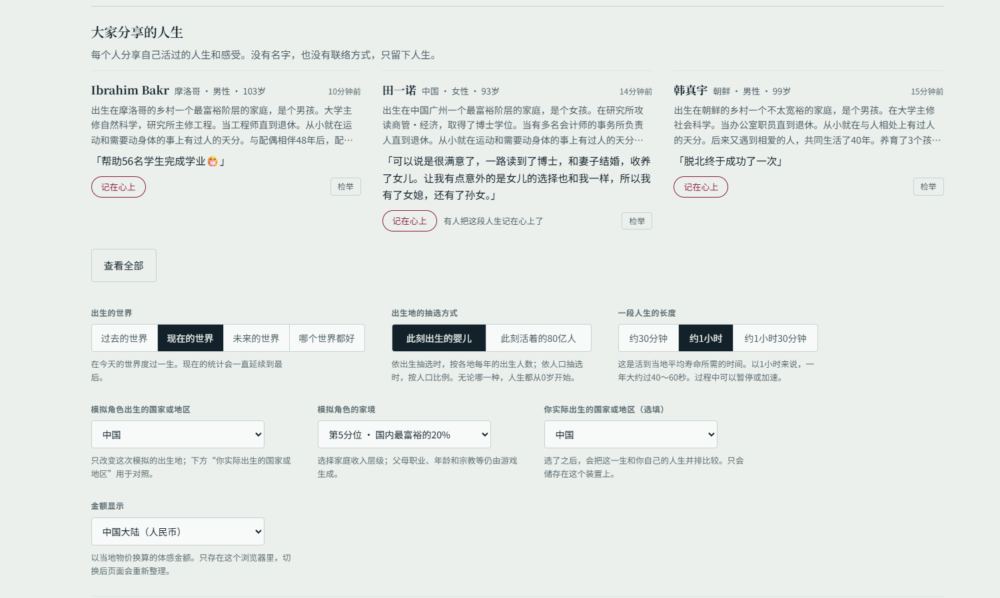

# 1in8b 出生国家与家境选择器

为 [80亿分之1](https://1in8b.life/zh-hans/) 简体中文版增加两个出生前选项：

- 模拟角色出生的国家或地区
- 模拟角色的家境（国内收入第 1 至第 5 分位）

两个选项都可以保留网站原有的随机规则。家境选择影响家庭收入分位；父母职业、年龄、宗教等其他细节仍由游戏生成。此脚本为非官方个人改进，不隶属于原网站。

## 安装

1. 在浏览器中安装 Tampermonkey。
2. 打开 [`rea-country-picker.user.js`](rea-country-picker.user.js)，将其内容复制到 Tampermonkey 的新脚本中并保存。
3. 刷新 [网站简体中文版](https://1in8b.life/zh-hans/)。在“出生”按钮上方选择国家和家境。

如果以前安装过旧版脚本，请编辑旧脚本并替换全部内容；本地文件更新不会自动同步到 Tampermonkey。

## 效果

脚本会临时接入网站已有的出生逻辑，生成角色后立即恢复原函数。网站更新后，如果其内部函数发生变化，脚本可能需要随之更新。
